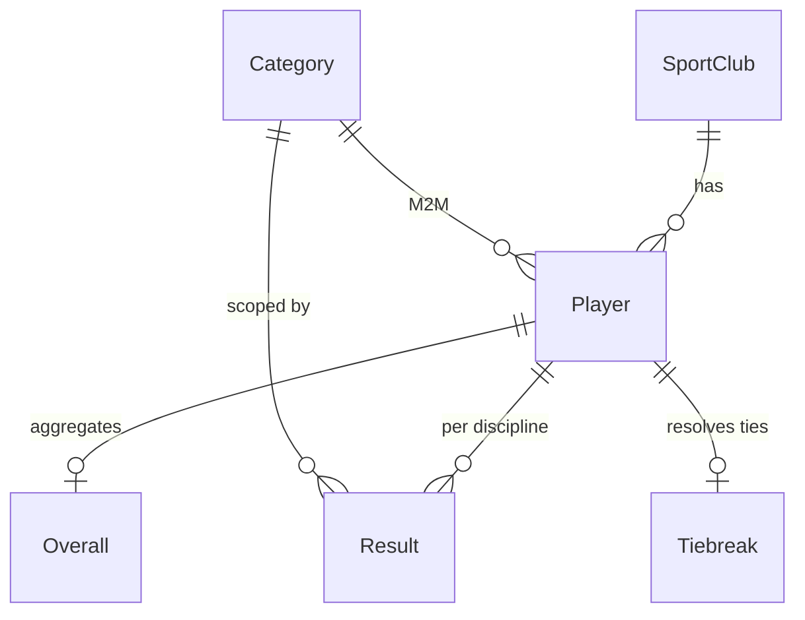

<div align="center">

# 🏆 European Championship Kettlebell

**Live scoring & results platform for the Hardstyle Kettlebell European Championship**

[](https://www.djangoproject.com/)
[](https://www.django-rest-framework.org/)
[](https://react.dev/)
[](https://www.typescriptlang.org/)
[](https://vitejs.dev/)
[](https://ant.design/)
[](https://www.python.org/)
[](https://www.postgresql.org/)
[](./LICENSE)

</div>

---

## 📖 Overview

**European Championship Kettlebell** is a full-stack web application built to run and broadcast
live results for the Hardstyle Kettlebell European Championship. It combines a robust Django
admin — used by organizers, judges and station operators to enter results — with a modern,
mobile-friendly React front-end that streams scores, rankings and start lists to spectators in
real time.

The system models the complete competition workflow: sport clubs, athletes, weight categories,
disciplines, per-station results, tie-break rules and an overall ranking derived from the
individual events.

## ✨ Features

- 🥇 **Live results** for every discipline — updated as judges submit scores.
- 📋 **Auto-generated start list** grouped by category, weight class and club.
- 🧮 **Automatic scoring & ranking**, including tie-break resolution.
- 🏋️ **Full discipline coverage:** Snatch, Turkish Get-Up (TGU), Kettlebell Squat,
  One Kettlebell Press, Two Kettlebell Press, Pistol Squat, See-Saw Press.
- 🏛 **Rich Django Admin** powered by [Jazzmin](https://django-jazzmin.readthedocs.io/) with
  bulk **import / export** (CSV, XLSX) via `django-import-export`.
- 🔌 **REST API** (Django REST Framework) consumed by the SPA and available for integrators.
- 📱 **Responsive SPA** built with React 19, Vite, TypeScript, Ant Design and TanStack Query.
- 🐳 **Production-ready** setup with Gunicorn, PostgreSQL, static files, CORS and database
  backups (`django-dbbackup`).

## 🧱 Architecture

```
┌───────────────────────────┐         REST/JSON        ┌───────────────────────────┐
│  React 19 + Vite SPA      │ ───────────────────────▶ │  Django 5.2 + DRF API     │
│  (Ant Design, TanStack)   │ ◀─────────────────────── │  (live_results app)       │
└───────────────────────────┘                          └────────────┬──────────────┘
                                                                    │
                                                                    ▼
                                                        ┌───────────────────────────┐
                                                        │      PostgreSQL           │
                                                        └───────────────────────────┘
```

- **`backend/`** — Django project `european_champonship_kettlebell` with the `live_results` app
  (models split by domain: `Player`, `SportClub`, `Category`, per-discipline result models,
  `Tiebreak`, `Overall`).
- **`frontend/`** — Vite + React + TypeScript SPA with pages for the home dashboard, category
  results, the live view and contact info.

### Domain model (simplified)



## 🧭 Tech Stack

| Layer     | Technologies |
|-----------|--------------|
| Backend   | Python 3.12, Django 5.2, Django REST Framework, Gunicorn, Jazzmin, django-import-export, django-cors-headers, django-dbbackup |
| Database  | PostgreSQL (via `psycopg2-binary`) |
| Frontend  | React 19, TypeScript 5.7, Vite 6, Ant Design 5, TanStack Query, React Router 7, Axios |
| Tooling   | Ruff, mypy, pre-commit, ESLint, factory_boy, Faker |

## 📁 Project structure

```
european_championship_kettlebell/
├── backend/
│   └── european_champonship_kettlebell/
│       ├── manage.py
│       ├── requirements.txt
│       ├── pyproject.toml
│       ├── european_champonship_kettlebell/    # project (settings, urls, wsgi/asgi)
│       │   └── settings/ (base.py, prod.py)
│       └── live_results/                        # main Django app
│           ├── models/  (player, sport_club, category, tiebreak, results/*)
│           ├── views.py, serializers.py, urls.py
│           ├── services.py, signals.py, resources.py
│           ├── templates/ (start_list.html, station_form.html, admin/)
│           └── management/commands/
└── frontend/
    ├── package.json, vite.config.ts, tsconfig*.json
    └── src/
        ├── App.tsx, main.tsx
        ├── pages/       (HomePage, CategoryPage, LivePage, ContactPage)
        ├── components/  (Layout)
        └── services/api.ts
```

## 🚀 Getting started

### Prerequisites

- **Python** 3.12+
- **Node.js** 20+ and **npm**
- **PostgreSQL** 14+ (a local instance or a Docker container)
- **Git**

### 1) Clone the repository

```bash
git clone https://github.com/merynos94/european_championship_kettlebell.git
cd european_championship_kettlebell
```

### 2) Backend setup

```bash
cd backend/european_champonship_kettlebell

python -m venv .venv
source .venv/bin/activate            # Windows: .venv\Scripts\activate

pip install --upgrade pip
pip install -r requirements.txt
```

Create a `.env` file next to `manage.py` (values below are examples):

```env
DJANGO_SECRET_KEY=change-me
DJANGO_DEBUG=True
DJANGO_ALLOWED_HOSTS=127.0.0.1,localhost

DB_NAME=kettlebell
DB_USER=kettlebell
DB_PASSWORD=kettlebell
DB_HOST=127.0.0.1
DB_PORT=5432

CORS_ALLOWED_ORIGINS=http://localhost:5173
```

Apply migrations, create an admin user and start the dev server:

```bash
python manage.py migrate
python manage.py createsuperuser
python manage.py runserver
```

The API is now available at `http://localhost:8000/api/` and the admin at
`http://localhost:8000/admin/`.

### 3) Frontend setup

```bash
cd ../../frontend
npm install
npm run dev
```

The SPA runs at `http://localhost:5173` and proxies `/api/` calls to the Django backend
(see [frontend/vite.config.ts](frontend/vite.config.ts)).

## 🧪 Available scripts

### Backend

```bash
python manage.py runserver          # start dev server
python manage.py migrate            # apply DB migrations
python manage.py createsuperuser    # create admin user
python manage.py collectstatic      # collect static assets (prod)
python manage.py dbbackup           # database backup (django-dbbackup)
python manage.py test               # run tests
```

### Frontend

```bash
npm run dev        # start Vite dev server
npm run build      # type-check and build production bundle
npm run preview    # preview production build locally
npm run lint       # run ESLint
```

## 🔌 REST API

Base URL: `/api/`

| Method | Endpoint                | Description                                  |
|-------:|-------------------------|----------------------------------------------|
| GET    | `/categories/`          | List all competition categories              |
| GET    | `/categories/{id}/`     | Category detail with results & ranking       |
| GET    | `/sportclubs/`          | List all sport clubs                         |
| GET    | `/sportclubs/{id}/`     | Sport club detail                            |
| GET    | `/lista-startowa/`      | HTML-rendered official start list            |

Routes are registered in [backend/european_champonship_kettlebell/live_results/urls.py](backend/european_champonship_kettlebell/live_results/urls.py).

## 📥 Importing athletes

Sample athlete data is provided as `zawodnicy_part_*.csv` files next to `manage.py`.
Use the Django admin (**Players → Import**) or `django-import-export` resources defined in
[backend/european_champonship_kettlebell/live_results/resources.py](backend/european_champonship_kettlebell/live_results/resources.py)
to bulk-load competitors.

## 🏗 Production deployment

- Use `european_champonship_kettlebell.settings.prod` as `DJANGO_SETTINGS_MODULE`.
- Serve the WSGI app with **Gunicorn** (already listed in `requirements.txt`), fronted by
  Nginx or another reverse proxy handling TLS and static files.
- Run `python manage.py collectstatic` and serve `staticfiles/` from the proxy.
- Build the frontend with `npm run build` and serve `frontend/dist/` as static content
  (or mount it behind the same reverse proxy so `/api/` hits Django).
- Schedule regular `python manage.py dbbackup` runs.

## 🧹 Code quality

- **Python:** [Ruff](https://docs.astral.sh/ruff/) (lint + format), [mypy](https://mypy.readthedocs.io/),
  [pre-commit](https://pre-commit.com/). Configuration lives in
  [backend/european_champonship_kettlebell/pyproject.toml](backend/european_champonship_kettlebell/pyproject.toml).
- **TypeScript:** ESLint with `typescript-eslint` and React hooks rules
  ([frontend/eslint.config.js](frontend/eslint.config.js)).

Enable git hooks once, then Ruff/mypy will run on every commit:

```bash
pre-commit install
```

## 🤝 Contributing

1. Fork the repository and create a feature branch: `git checkout -b feat/my-feature`.
2. Install and enable `pre-commit` hooks.
3. Add tests where it makes sense and ensure `python manage.py test` and `npm run lint` pass.
4. Open a Pull Request against `develop` with a clear description.

Issues and feature requests are welcome via the GitHub issue tracker.

## 📜 Changelog

See [CHANGELOG.md](CHANGELOG.md).

## 👤 Authors

See [AUTHORS.md](AUTHORS.md).

- **Radosław Mikoś** — [merynos94@gmail.com](mailto:merynos94@gmail.com)

## 📄 License

Distributed under the **MIT License**. See [LICENSE](LICENSE) for details.
